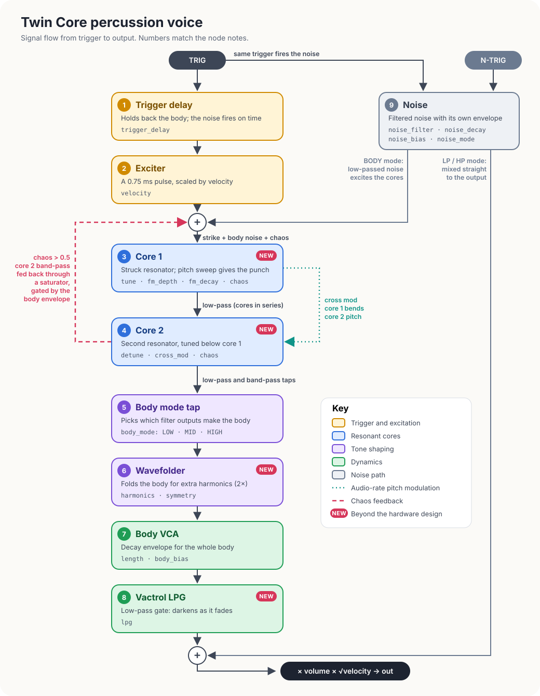

# Twin Core percussion voice

Twin Core is a percussion voice built from two struck resonators. It is a digital interpretation of the signal order in the SSF Entity Ultra-Perc, not a circuit model of it. A trigger strikes core 1. Core 1 rings into core 2, and the result passes through a mode tap, a wavefolder, a VCA and a low-pass gate. A separately enveloped noise source is either mixed in at the end or used to excite the cores.

Four controls go beyond the hardware: **symmetry**, **cross mod**, **lpg** and **chaos**. With all four at their defaults the voice renders exactly as it did before they existed. They are marked **NEW** in the diagram.

The source is `src/instruments/twin_core_perc.rs`, plus `src/filters/resonator.rs` and `src/filters/vactrol_lpg.rs`.

## Nodes

| # | Node | Role |
|---|---|---|
| 1 | [Trigger delay](nodes/01-trigger-delay.md) | Holds back the body strike; the noise still fires on time |
| 2 | [Exciter](nodes/02-exciter.md) | Short pulse that strikes core 1 |
| 3 | [Core 1](nodes/03-core-1.md) | First resonator; carries the pitch sweep |
| 4 | [Core 2](nodes/04-core-2.md) | Second resonator, in series, tuned below core 1 |
| 5 | [Body mode tap](nodes/05-body-mode-tap.md) | Picks which filter outputs form the body |
| 6 | [Wavefolder](nodes/06-wavefolder.md) | Adds harmonics by folding the waveform |
| 7 | [Body VCA](nodes/07-body-vca.md) | Decay envelope for the body |
| 8 | [Vactrol LPG](nodes/08-vactrol-lpg.md) | Low-pass gate that darkens as it fades |
| 9 | [Noise](nodes/09-noise.md) | Filtered noise with its own envelope |

## Output

The body and the direct noise are summed, then multiplied by `volume` (0–2) and by the square root of the hit velocity. The result is clamped to ±4. A voice deactivates once its body and noise envelopes have both run for twice their length and both cores have gone quiet.

## Parameter map

All parameters are set as normalized 0–1 values. Tune, length, FM decay, noise filter and noise decay map exponentially; the rest map linearly.

| Parameter | Range | Node | Channel index | Standalone index |
|---|---|---|---|---|
| `tune` | 20–2000 Hz | 3 | 0 | 0 |
| `detune` | 0–2.5 octaves below core 1 | 4 | 1 | 1 |
| `length` | 0.002–20 s | 3, 4, 7 | 2 | 2 |
| `body_bias` | −1 to 1 | 3, 4, 7 | 3 | 3 |
| `fm_decay` | 0.002–8 s | 3 | 4 | 4 |
| `fm_depth` | −5 to 5 octaves | 3 | 5 | 5 |
| `trigger_delay` | 0–75 ms | 1 | 6 | 6 |
| `harmonics` | 0–1 | 6 | 7 | 7 |
| `noise_filter` | 20 Hz to 0.45 × sample rate | 9 | 8 | 8 |
| `noise_decay` | 0.002–20 s | 9 | 9 | 9 |
| `noise_bias` | −1 to 1 | 9 | 10 | 10 |
| `volume` | 0–2 | output | 11 | 11 |
| `body_mode` | LOW, MID, HIGH | 5 | 12 (0–2) | `gooey_twin_core_perc_set_body_mode` |
| `noise_mode` | LP, HP, BODY | 9 | 13 (0–2) | `gooey_twin_core_perc_set_noise_mode` |
| `symmetry` (new) | −1 to 1 | 6 | 14 | 12 |
| `cross_mod` (new) | 0–1 | 4 | 15 | 13 |
| `lpg` (new) | 0–1 | 8 | 16 | 14 |
| `chaos` (new) | 0–1 | 3, 4 | 17 | 15 |

Channel indices are the `TWIN_CORE_PARAM_*` constants used with `gooey_engine_set_channel_param`. Standalone indices are used with `gooey_twin_core_perc_set_parameter`; the new ones are named `TWIN_CORE_PERC_PARAM_*`.
